# Lab2: Git Private Repo Integration with Jenkins (Docker)

## Goal

This lab deals with both Jenkins configuration and private Github repository.
The goal of this lab is to learn how to configure Jenkins environmental variable and create
ssh private/public key and authenticate with Github to checkout its private repo.

To check out code from a **private** GitHub repository using the official `jenkins/jenkins:lts` Docker image, you need to spin up the container and provide Jenkins with authenticating credentials. The image already comes with `git` pre-installed, so you do not need to modify the image itself. ([ref1](https://piotrminkowski.com/2018/06/12/local-continuous-delivery-environment-with-docker-and-jenkins/), [ref2](https://www.youtube.com/watch?v=vsEI0HIv8b4))

You can accomplish this using either **HTTPS (Personal Access Token)** or **SSH (Deploy Keys)**. ([ref1](https://medium.com/@mai.vly/setup-jenkins-for-your-application-from-the-private-github-repo-with-docker-bac79335ff27), [ref2](https://www.youtube.com/watch?v=vsEI0HIv8b4))

### Knowledge

* Private/Public key

You can find some introduction here,

- https://kevinli-webbertech.github.io/blog/html/courses/cybersecurity/public_private_key.html
- https://kevinli-webbertech.github.io/blog/html/courses/cybersecurity/mathematics.html

* Jenkins Environmental variables

* Github Configurations

## Labs

### Step 1: Start the Jenkins Container and Log In

#### 1.1 Run the `jenkins/jenkins:lts` container

Start by running the official LTS container: ([ref1](https://piotrminkowski.com/2018/06/12/local-continuous-delivery-environment-with-docker-and-jenkins/))

```bash
docker run -d \
  --name jenkins \
  -p 8080:8080 \
  -p 50000:50000 \
  -v jenkins_home:/var/jenkins_home \
  jenkins/jenkins:lts
```

#### 1.2 If the container name is already in use

If you ran this lab (or another Jenkins lab) before, Docker refuses to create a second container named `jenkins`:

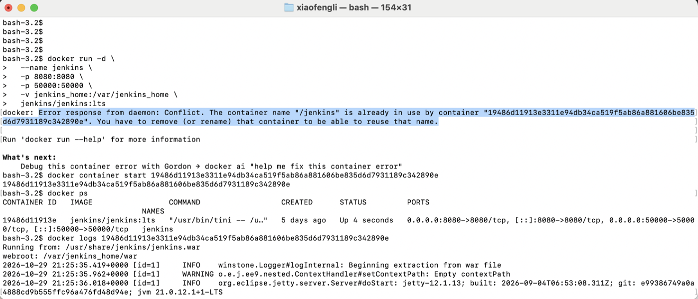

Do not create a new one. Start the existing container using the ID printed in the error message (or simply `docker start jenkins`):

```bash
docker container start <container-id>
```

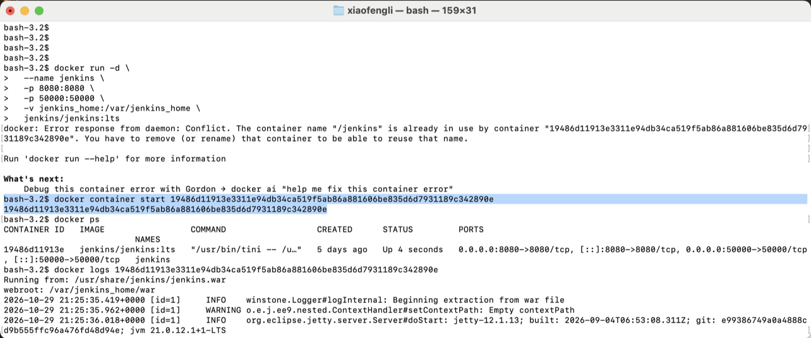

> Note: your Jenkins data (jobs, credentials, plugins) lives in the `jenkins_home` volume, so an existing container keeps its previous configuration. Only run `docker rm -f jenkins` if you really want to start from scratch, and note that the volume must also be removed with `docker volume rm jenkins_home` for a truly clean start.

#### 1.3 Confirm that the container is running

```bash
docker ps
```

The `STATUS` column should say `Up ...` and `PORTS` should show `0.0.0.0:8080->8080/tcp`.

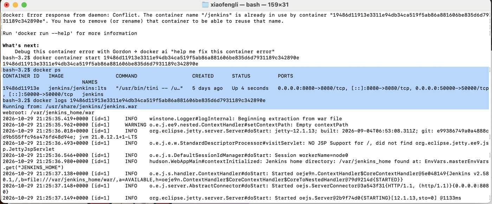

#### 1.4 Fetch the initial administrator password

Jenkins prints a one-time password to its log the first time it starts. Show the log with the container ID or name from `docker ps`:

```bash
docker logs jenkins
```

Scroll to the block surrounded by asterisks. The 32-character string is the initial admin password (the same value is also stored in `/var/jenkins_home/secrets/initialAdminPassword`). You can also print only the password with:

```bash
docker exec jenkins cat /var/jenkins_home/secrets/initialAdminPassword
```

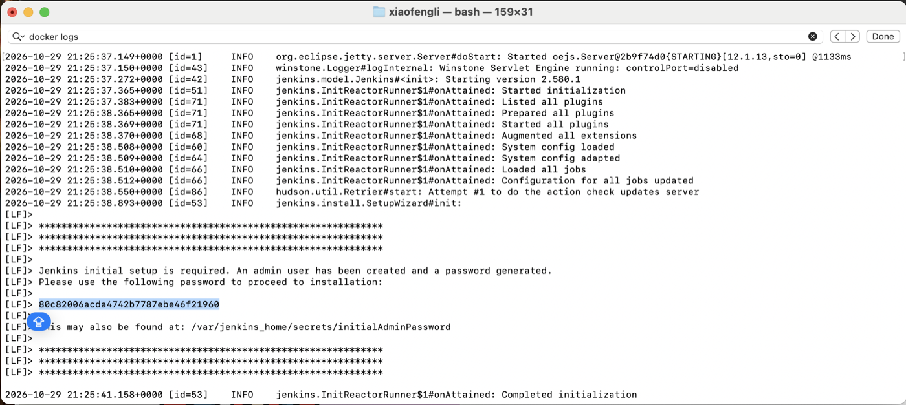

> The password is unique to your own container; do not copy the one in the screenshot. If Jenkins has already been set up, you will not see this block and you log in with the admin account you created earlier.

#### 1.5 Log in to Jenkins

1. Open `http://localhost:8080` in your browser.
2. On the **Unlock Jenkins** page, paste the initial administrator password and click **Continue**.
3. Choose **Install suggested plugins** (this includes the **Git** and **Pipeline** plugins) and wait for the installation to finish.
4. Create your first admin user (or choose **Continue as admin**), keep the default Jenkins URL, and click **Start using Jenkins**.

You are ready when the Jenkins dashboard opens, with a **New Item** link in the left menu.

### Step 2: Choose Your Authentication Method

#### Option A: Authenticate via HTTPS (Personal Access Token) - Easiest

**2A.1 Generate a Personal Access Token (PAT) on GitHub**

1. Sign in to GitHub, click your profile picture in the top-right corner, and choose **Settings**.

   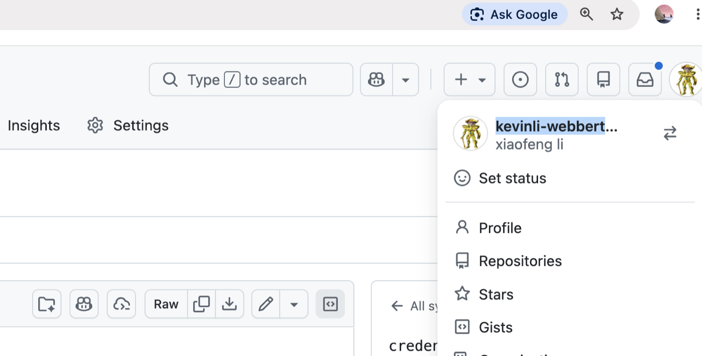

2. In the left sidebar, scroll to the bottom and click **Developer settings**.

   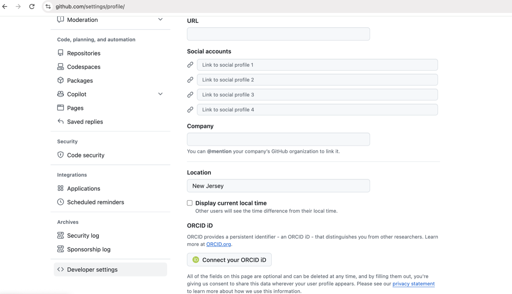

3. Expand **Personal access tokens**. You can choose **Fine-grained tokens** (recommended, limited to selected repositories) or **Tokens (classic)**.

   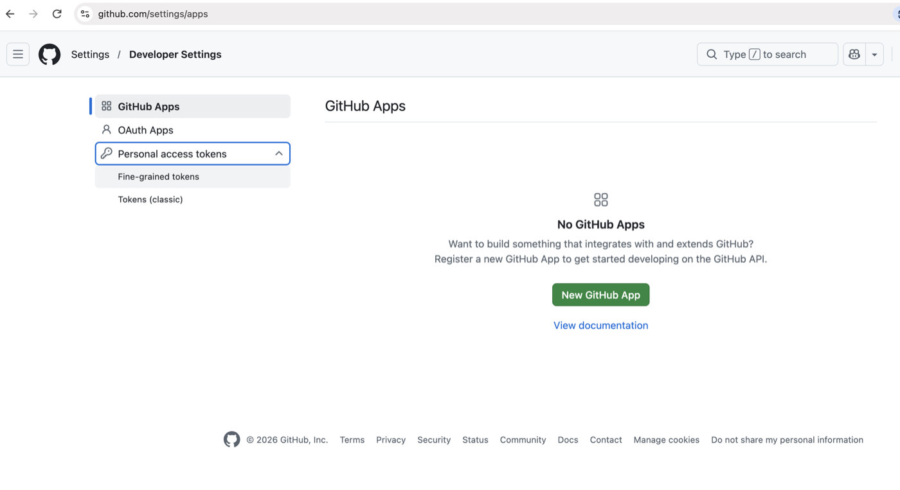

4. Click **Generate new token** and fill in the form:

   * **Token name:** `jenkin_pipeline`
   * **Expiration:** pick a limited lifetime (a token without an expiration date is a security risk)
   * **Repository access:** *Only select repositories*, then choose your private repository
   * **Permissions** > **Repository permissions** > **Contents:** *Read-only* (Metadata read access is added automatically)

   If you prefer a **classic** token, check the `repo` scope instead.

5. Click **Generate token** and **copy the token immediately**. GitHub shows it only once. Treat it like a password: never commit it to a repository or paste it into a Jenkinsfile.

6. The token now appears in the list of tokens:

   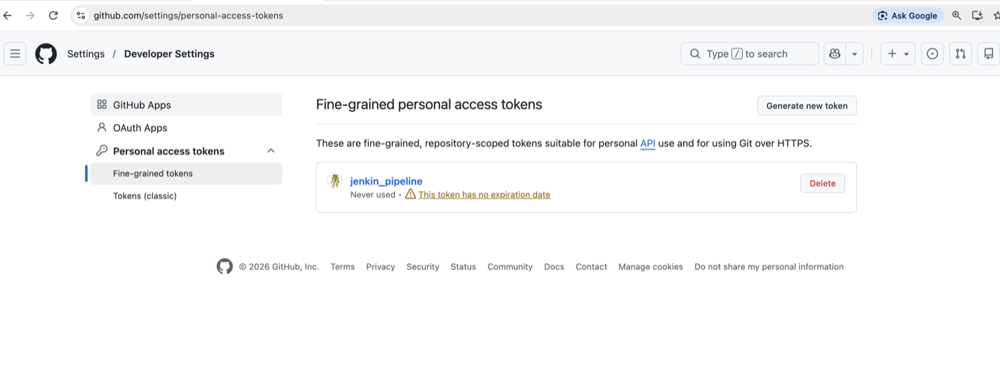

**2A.2 Add the token to Jenkins as a credential**

1. In Jenkins, click **Manage Jenkins** (the gear icon), then open **Credentials**.

   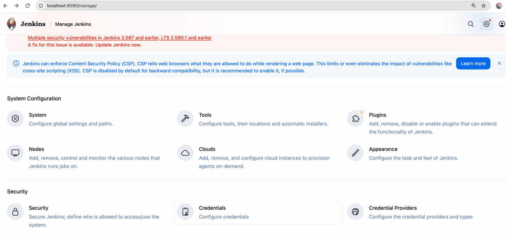

2. Open **System** > **Global credentials (unrestricted)** and click **Add Credentials** (this dialog is also reachable from the **Add** button next to the *Credentials* drop-down while configuring a job).

3. Fill in the form:

   * **Kind:** Username with password
   * **Scope:** Global
   * **Username:** Your GitHub username (for example `kevinli-webbertech`)
   * **Password:** Paste your GitHub Personal Access Token
   * **ID:** `github-token` (this ID is referenced later in the Jenkinsfile) ([ref1](https://www.youtube.com/watch?v=Xs6bXpJsGu4&t=150), [ref2](https://www.youtube.com/watch?v=t-UAzkZTKZI&t=362))

   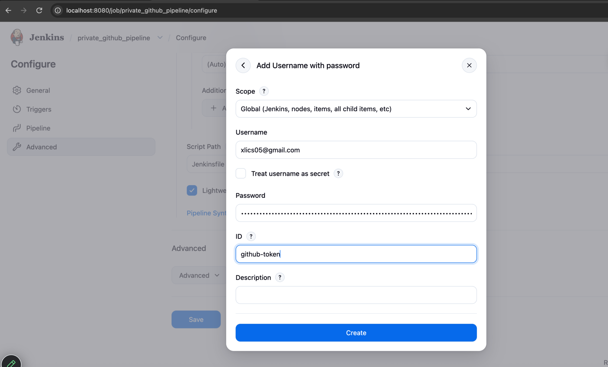

4. Click **Create**. The new credential appears in the list with its password masked:

   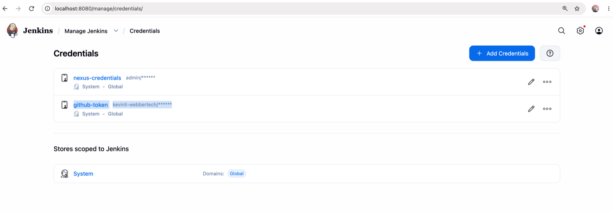

The Repository URL for a job will be the HTTPS variant (e.g., `https://github.com/<username>/<repo>.git`) together with this credential. ([ref1](https://www.youtube.com/watch?v=t-UAzkZTKZI&t=362))

#### Option B: Authenticate via SSH (Deploy Keys) - More Secure

1. **Generate SSH Keypair**: Open your terminal and generate an SSH key pair: ([ref1](https://medium.com/@mai.vly/setup-jenkins-for-your-application-from-the-private-github-repo-with-docker-bac79335ff27))

   ```bash
   ssh-keygen -t ed25519 -C "jenkins-deploy-key" -f ./jenkins_key
   ```

2. **Add Public Key to GitHub**: Go to your GitHub Private Repository > **Settings** > **Deploy keys** > **Add deploy key**. Paste the contents of `jenkins_key.pub`. ([ref1](https://medium.com/@mai.vly/setup-jenkins-for-your-application-from-the-private-github-repo-with-docker-bac79335ff27))

3. **Add Private Key to Jenkins**: Go to **Manage Jenkins** > **Credentials** > **System** > **Global credentials** > **Add Credentials**.

   * **Kind:** SSH Username with private key
   * **Username:** `git`
   * **Private Key:** Select **Enter directly** and paste the entire contents of your private key file (`jenkins_key`).
   * **ID:** `github-ssh` ([ref1](https://medium.com/@mai.vly/setup-jenkins-for-your-application-from-the-private-github-repo-with-docker-bac79335ff27), [ref2](https://www.youtube.com/watch?v=Xs6bXpJsGu4&t=150))

4. **Configure your Pipeline/Job**: Use the SSH repository URL (e.g., `git@github.com:your-username/your-repo.git`) and link your SSH credentials. ([ref1](https://medium.com/@mai.vly/setup-jenkins-for-your-application-from-the-private-github-repo-with-docker-bac79335ff27))

### Step 3: Create the Jenkinsfile in Your Private Repository

A `Jenkinsfile` is a text file at the root of your repository that describes the pipeline. In your private GitHub repository, click **Add file** > **Create new file**, name it `Jenkinsfile` (no extension), paste the pipeline below, and click **Commit changes** on the `main` branch.

The complete file used in this lab is also available here: [Jenkinsfile](https://kevinli-webbertech.github.io/blog/md/courses/dev_ops/github/labs/lab2_jenkins_pipeline/Jenkinsfile) (from the sample repository https://github.com/kevinli-webbertech/gs-spring-boot-private, a Spring Boot project).

```groovy
pipeline {
    agent any // Specifies that the pipeline can run on any available agent

    options {
      skipStagesAfterUnstable()
    }

    tools {
        maven '3.9.11'
    }

    stages {
        stage('Checkout') {
            steps {
                git branch: 'main',
                    credentialsId: 'github-token',
                    url: 'https://github.com/kevinli-webbertech/gs-spring-boot-private.git'
            }
        }

         stage('Test') {
            steps {
                sh 'mvn clean test'
            }
        }

        stage('Build and Package') {
            steps {
                sh 'mvn clean package -DskipTests'
            }
        }

        stage('Archive Artifacts') {
            steps {
                archiveArtifacts artifacts: 'target/*.jar', fingerprint: true
            }
        }
    }


    post {
        always {
            echo 'Pipeline finished.'
        }
        success {
            echo 'Build successful!'
        }
        failure {
            echo 'Build failed!'
        }
    }
}
```

The pipeline has four stages: **Checkout** (clone the private repo with the `github-token` credential), **Test** (`mvn clean test`), **Build and Package** (`mvn clean package -DskipTests`) and **Archive Artifacts** (keep the `target/*.jar` file). The `post` section prints a message when the pipeline finishes.

Things to adjust for your own repository:

* Replace the `url` with your own account and private repository name. For SSH (Option B), use `git@github.com:<username>/<repo>.git` and `credentialsId: 'github-ssh'`.
* `credentialsId` must be exactly the **ID** you typed when creating the Jenkins credential (`github-token`).
* The `tools { maven ... }` block needs a Maven installation with the same name. In Jenkins go to **Manage Jenkins** > **Tools** > **Maven installations** > **Add Maven**, set the name (e.g. `3.9.11`), keep **Install automatically** checked, and **Save**. If you remove the `tools` block, the `jenkins/jenkins:lts` image will not have the `mvn` command, and the `Test` and `Build and Package` stages fail.
* Use the build commands that match your project (`mvn`, `./gradlew build`, `npm ci && npm test`, and so on).

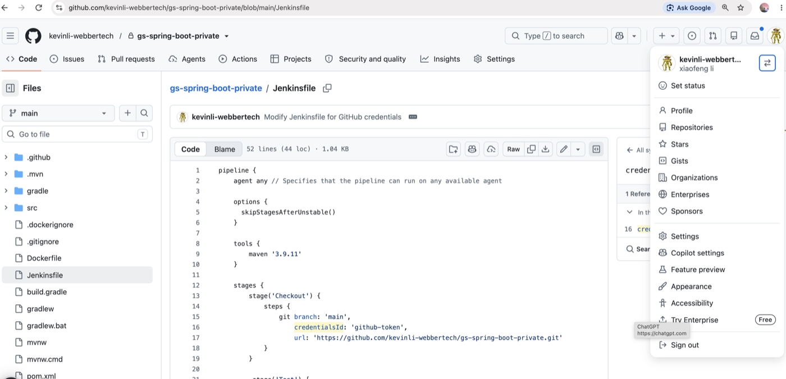

### Step 4: Create the Pipeline Job in Jenkins

1. On the Jenkins dashboard, click **New Item**.
2. In **Enter an item name**, type `private_github_pipeline`.
3. Select **Pipeline** and click **OK**.

   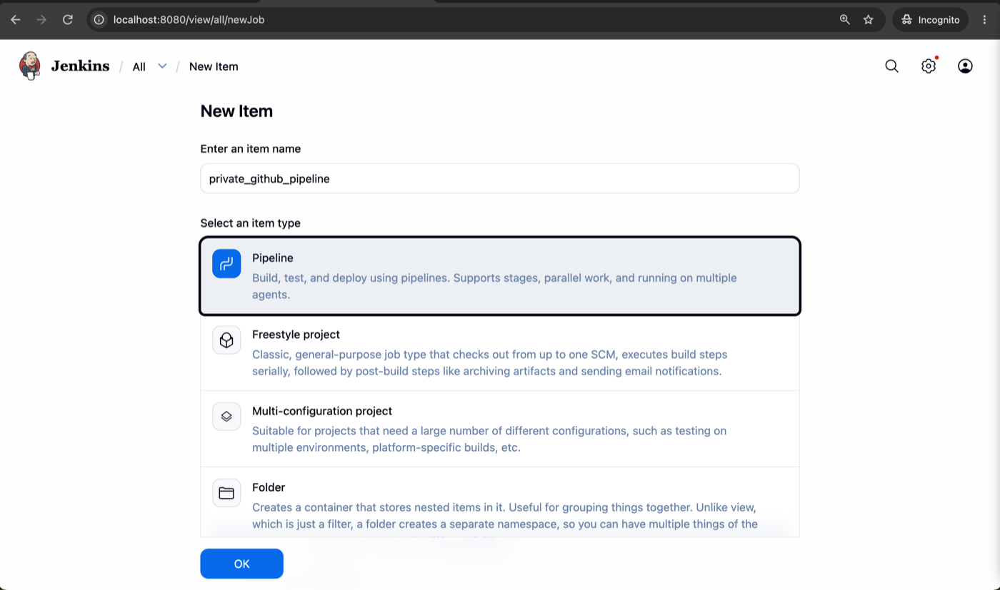

4. On the **Configure** page, open the **Pipeline** section and set:

   * **Definition:** *Pipeline script from SCM*
   * **SCM:** *Git*
   * **Repository URL:** `https://github.com/<username>/<repo>.git`
   * **Credentials:** select `github-token` (use **Add** if you did not create it in Step 2)
   * **Branch Specifier:** `*/main`
   * **Script Path:** `Jenkinsfile`

5. Click **Save**.

If Jenkins can read the repository, no error appears under the **Repository URL** field. A message such as `Authentication failed` or `not found` means the token, the username, or the repository URL is wrong.

### Step 5: Build the Job and Verify the Result

1. On the job page, click **Build Now** in the left menu. A new build (for example `#5`) appears in **Builds** with a blue progress bar.

   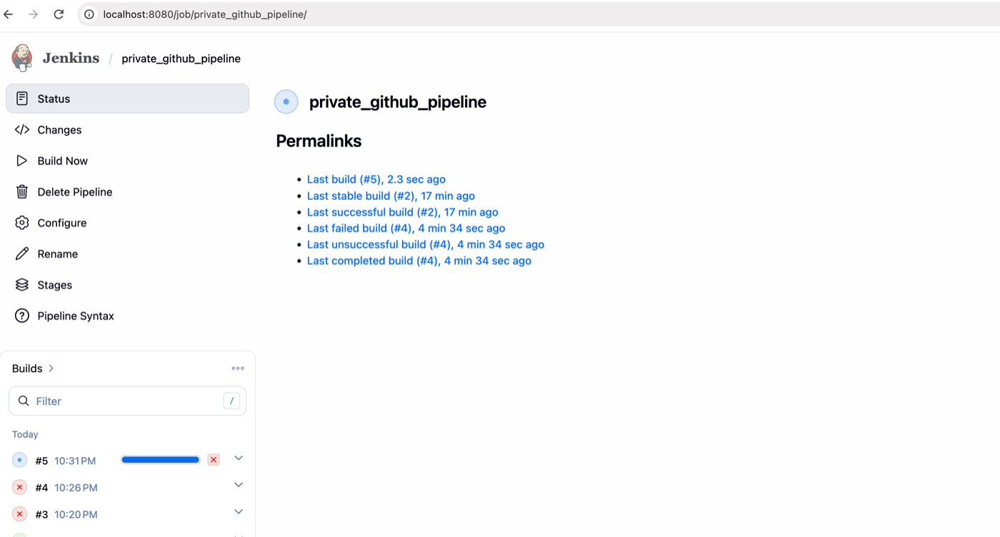

2. Click the build number, then **Console Output** to watch the log. You should see the code being checked out from the private repository and the Maven build running:

   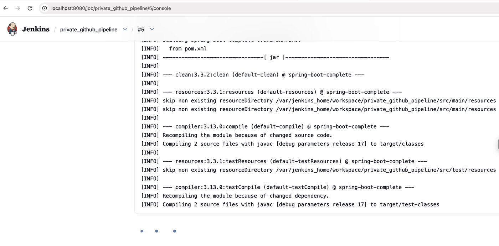

3. The build is successful when the console ends with the post actions and `Finished: SUCCESS`, and the build icon is green:

   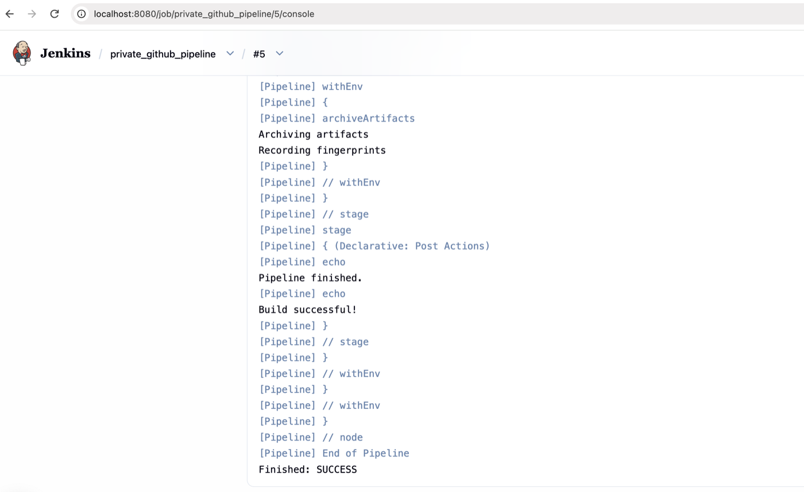

4. Optional check: open **Manage Jenkins** > **Credentials** > `github-token`. The **Usage** section lists your pipeline job and the builds that used the credential:

   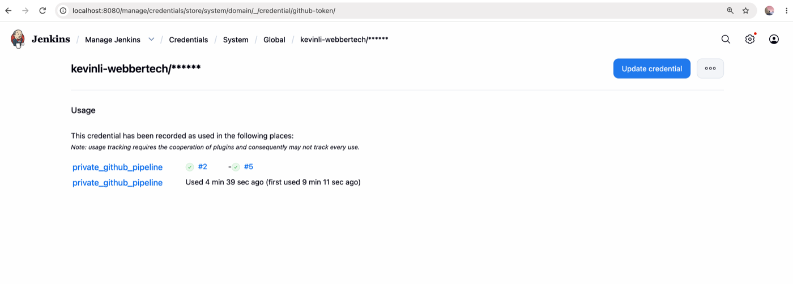

A red build means the pipeline failed. Open **Console Output**, read the first error message from the top of the failure, fix the cause (credentials, URL, Maven tool name, or a build error), and click **Build Now** again.

## Troubleshooting

If you run into issues, check the following:

* Which **authentication type** (HTTPS token or SSH key) you are using.
* Any **error codes** or console output you see during checkout.

| Symptom | Likely cause and fix |
| --- | --- |
| `docker: Error response from daemon: Conflict. The container name "/jenkins" is already in use` | A container with that name exists. Use `docker start jenkins` instead of `docker run`. |
| Cannot open `http://localhost:8080` | Run `docker ps`, make sure the container is `Up`, and wait about a minute for Jenkins to finish starting. Check `docker logs jenkins`. |
| `Authentication failed` / `remote: Repository not found` at checkout | Wrong username or token, expired token, or the token cannot access this private repository (fine-grained tokens need **Contents: Read** on that repo). |
| `Could not find credentials entry with ID 'github-token'` | The `credentialsId` in the Jenkinsfile does not match the Jenkins credential **ID**. |
| `mvn: not found` or `Tool type "maven" does not have an install of "3.9.11"` | Add a Maven installation with that exact name in **Manage Jenkins** > **Tools**, or change the name in the Jenkinsfile. |
| Job stays `Pending - Waiting for next available executor` | Check **Manage Jenkins** > **Nodes**; the built-in node must be online and have executors. |

## Ref

- https://piotrminkowski.com/2018/06/12/local-continuous-delivery-environment-with-docker-and-jenkins/
- https://www.youtube.com/watch?v=vsEI0HIv8b4
- https://medium.com/@mai.vly/setup-jenkins-for-your-application-from-the-private-github-repo-with-docker-bac79335ff27
- https://tesh.digital/set-up-a-cicd-server-and-configure-for-use-with-private-github-repositories
- https://www.youtube.com/watch?v=Xs6bXpJsGu4&t=150
- https://www.youtube.com/watch?v=t-UAzkZTKZI&t=362
- https://stackoverflow.com/questions/9767919/in-jenkins-how-to-checkout-a-project-into-a-specific-directory-using-git

## Lab Document

- https://kevinli-webbertech.github.io/blog/md/courses/dev_ops/github/labs/GitPrivateRepoIntegrationWithJenkin.pdf
