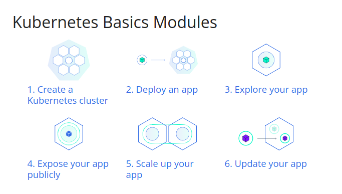
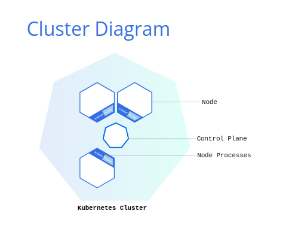

# Kubernetes Basics

## Kubernetes

A Kubernetes cluster can be deployed on either physical or virtual machines. To get started with Kubernetes development, you can use Minikube.

## Minikube

In this tutorial we will use the command line tool `minikube`. Minikube runs a local Kubernetes cluster using containers or virtual machines, depending on the driver. It starts with one node by default and also supports multi-node clusters. Minikube is available for Linux, macOS, and Windows systems. The Minikube CLI provides basic bootstrapping operations for working with your cluster, including start, stop, status, and delete.

`minikube` is local Kubernetes, focusing on making it easy to learn and develop for Kubernetes.

All you need is Docker (or similarly compatible) container or a Virtual Machine environment,

What you’ll need

- 2 CPUs or more
- 2GB of free memory
- 20GB of free disk space
- Internet connection
- Container or virtual machine manager, such as: Docker, QEMU, Hyperkit, Hyper-V, KVM, Parallels, Podman, VirtualBox, or VMware Fusion/Workstation

## Minikube Installation

Minikube is the K8s server managing software and it manages the cluster.

Here is the website for installing the `minikube`.

https://minikube.sigs.k8s.io/docs/start/?arch=%2Flinux%2Fx86-64%2Fstable%2Fbinary+download

For instance, on a Linux x86-64 machine:

```shell
curl -LO https://storage.googleapis.com/minikube/releases/latest/minikube-linux-amd64
sudo install minikube-linux-amd64 /usr/local/bin/minikube && rm minikube-linux-amd64
```

But we highly recommend you use the link above for the most up2date instruction.

## kubectl Installation

`kubectl` is the command line client for the Kubernetes API. Use it to inspect and manage Deployments, Pods, Services, and other cluster resources.

Here are some links to install it for different platforms,

* https://kubernetes.io/docs/tasks/tools/install-kubectl-linux/ (linux)
* https://kubernetes.io/docs/tasks/tools/install-kubectl-macos/ (mac)
* https://kubernetes.io/docs/tasks/tools/install-kubectl-windows/ (windows)

## Goal of Study in this article



## Start the server

```shell
minikube start
```

For a new local cluster with Docker already installed and running, you can explicitly select a driver and resource allocation:

```shell
minikube start --driver=docker --cpus=2 --memory=4096
```

These are alternative startup examples, not steps that must all be run.

| Option | Purpose |
| --- | --- |
| `--driver=docker` | Run Kubernetes nodes as Docker containers. Available drivers depend on your operating system. |
| `--cpus=2` | Allocate CPUs; leave enough resources for the host. |
| `--memory=4096` | Allocate memory in MB. |
| `--disk-size=30g` | Set the disk size for a VM-based driver. |
| `--nodes=2` | Create a multi-node cluster for scheduling practice; requires more host resources. |
| `--kubernetes-version=<version>` | Select a supported Kubernetes version, replacing `<version>` with a release such as `vX.Y.Z`. |
| `-p <profile>` | Select a named Minikube cluster, useful for separate labs. |

For example, `minikube start -p k8s-lab --driver=docker --nodes=2` creates a separate lab cluster. Use `-p k8s-lab` with subsequent Minikube commands for that cluster.

The examples below use the default `minikube` profile and the `default` namespace unless explicitly stated.

## Status

```shell
minikube status
minikube profile list
minikube version
kubectl version
kubectl cluster-info
kubectl get nodes -o wide
```

`kubectl version --client` checks only the installed client and does not require a reachable cluster.

## Dashboard

```shell
minikube dashboard
minikube dashboard --url
```

Use `--url` to print the dashboard URL instead of opening a browser automatically. Keep the command running while using its proxy.

## kubectl command structure and common options

The general structure is `kubectl <command> <resource> <name> [options]`.

| Option | Example | Purpose |
| --- | --- | --- |
| `-n`, `--namespace` | `kubectl get pods -n kube-system` | Select a namespace for this command. |
| `-A`, `--all-namespaces` | `kubectl get pods -A` | List a namespaced resource across all namespaces. |
| `-o wide` | `kubectl get pods -o wide` | Include fields such as Pod IP and node name. |
| `-o yaml`, `-o json` | `kubectl get deployment hello-node -o yaml` | Inspect the resource definition and status. |
| `-w`, `--watch` | `kubectl get pods -w` | Watch resource changes; press Ctrl+C to stop. |
| `-l`, `--selector` | `kubectl get pods -l app=hello-node` | Filter by labels. |
| `--field-selector` | `kubectl get pods --field-selector=status.phase=Running` | Filter supported resource fields; Running does not necessarily mean Ready. |
| `--show-labels` | `kubectl get pods --show-labels` | Display labels used by selectors. |
| `--context` | `kubectl --context=minikube get nodes` | Select a cluster context for one command. |
| `-f`, `--filename` | `kubectl apply -f deployment.yaml` | Read a manifest from a file. |
| `--dry-run=client` | `kubectl create deployment web --image=nginx:stable --dry-run=client -o yaml` | Generate a resource without creating it in the cluster. |

Options are command-specific. For example, `-f` means "follow" for `kubectl logs`, not "filename".

```shell
kubectl --help
kubectl get --help
kubectl options
kubectl api-resources
kubectl explain deployment.spec
kubectl explain deployment.spec.template.spec.containers
```

Common resource abbreviations include `po` (Pods), `svc` (Services), `deploy` (Deployments), `ns` (Namespaces), `cm` (ConfigMaps), and `pvc` (PersistentVolumeClaims).

## Contexts and namespaces

Check the target cluster before changing or deleting resources:

```shell
kubectl config current-context
kubectl config get-contexts
kubectl config use-context minikube
kubectl config view --minify
kubectl get namespaces
```

A context selects a cluster, credentials, and optionally a default namespace. Do not share kubeconfig files or unredacted credentials.

To keep a separate experiment in a namespace:

```shell
kubectl create namespace k8s-lab
kubectl get pods -n k8s-lab
```

`-n k8s-lab` applies only to that command. Alternatively, `kubectl config set-context --current --namespace=k8s-lab` changes the current context's default namespace persistently. Run `kubectl config set-context --current --namespace=default` before following the main tutorial below.

## Deployment

- Kubernetes coordinates a highly available cluster of computers that are connected to work as a single unit.
- Kubernetes automates the distribution and scheduling of application containers across a cluster in a more efficient way.

A Kubernetes cluster consists of two types of resources:



- The Control Plane coordinates the cluster
- Nodes are the workers that run applications

## Pod, Node, Deployment and Service

- Pod: the smallest deployable unit, containing one or more containers that share networking and storage volumes.
- Node: a virtual or physical machine that normally runs many Pods.
- Deployment: manages replicas and rolling updates through ReplicaSets, replacing Pods when needed. The kubelet on each node restarts failed containers according to their restart policy.
- Service: provides a stable network endpoint for a set of Pods, usually selected by labels.

  By default, the Pod is only accessible by its internal IP address within the Kubernetes cluster. To make the hello-node Container accessible from outside the Kubernetes virtual network, you have to expose the Pod as a Kubernetes Service.

**A hello-world image deployment**

- Create a Deployment

  - `kubectl create deployment hello-node --image=registry.k8s.io/e2e-test-images/agnhost:2.39 -- /agnhost netexec --http-port=8080`

- View the Deployment

  - `kubectl get deployments`

- View the Pod

  - `kubectl get pods`

- View cluster events

  - `kubectl get events`

- View the kubectl configuration

  - `kubectl config view`

- View the latest application logs from a Pod belonging to the Deployment.

  - `kubectl logs deployment/hello-node --tail=100`

- Create a service

  - Create a Service for the Deployment:
  - `kubectl expose deployment hello-node --type=LoadBalancer --port=8080 --target-port=8080`

The `--type=LoadBalancer` flag requests an external load balancer from the cluster's infrastructure. It does not automatically publish a local Minikube application to the public internet. `--port` is the Service port; `--target-port` is the application's listening port inside the Pod.

- View a service

  - `kubectl get services`

- Open the service locally

  - `minikube service hello-node`

## Inspect resources and wait for readiness

Run these commands after creating the `hello-node` Deployment:

```shell
kubectl get deployment,replicaset,pod,service
kubectl describe deployment hello-node
kubectl get pods -l app=hello-node -o wide
kubectl rollout status deployment/hello-node --timeout=120s
kubectl wait --for=condition=Ready pod -l app=hello-node --timeout=120s
kubectl get events --sort-by=.metadata.creationTimestamp
```

`get` provides a summary; `describe` includes conditions and related events. `rollout status` checks Deployment rollout progress, while `wait` waits for a condition on the selected resources and fails if the timeout expires.

For scripting, select only the fields you need:

```shell
kubectl get pods -l app=hello-node -o name
kubectl get pods -o custom-columns=NAME:.metadata.name,NODE:.spec.nodeName,PHASE:.status.phase
kubectl get service hello-node -o jsonpath='{.spec.clusterIP}{"\n"}'
```

`kubectl get all` is a convenient summary, not a complete inventory: it omits resources such as ConfigMaps, Secrets, and PersistentVolumeClaims.

## Logs and container troubleshooting

Replace `<pod-name>` and `<container-name>` with real names from your cluster; do not type the angle brackets literally.

```shell
kubectl logs deployment/hello-node --tail=100 --timestamps=true
kubectl logs -l app=hello-node --all-containers=true --prefix=true --since=10m
kubectl logs -f deployment/hello-node
kubectl describe pod <pod-name>
kubectl logs <pod-name> -c <container-name> --previous
kubectl exec <pod-name> -c <container-name> -- printenv
kubectl exec -it <pod-name> -c <container-name> -- /bin/sh
```

- `--tail` limits output; `--since` selects a recent time window; `-f` streams new log messages until Ctrl+C.
- Deployment-based logs select a Pod; a label selector can collect logs from multiple replicas.
- `-c` selects a container in a multi-container Pod. `--previous` retrieves the previous terminated instance's logs when available.
- For `exec`, `-i` keeps standard input open, `-t` allocates a terminal, and `--` separates kubectl options from the container command.
- Minimal images may not contain `printenv` or a shell. A missing executable does not mean the Pod is unhealthy.
- Environment variables and logs can contain credentials. Redact sensitive values before sharing output.

## Service access and networking

| Service type | Typical use |
| --- | --- |
| `ClusterIP` | Default; reachable within the cluster. |
| `NodePort` | Exposes a port on each node; reachability depends on node networking and firewalls. |
| `LoadBalancer` | Requests an external load balancer; requires infrastructure support. |

For local access without a load balancer, forward a local port to the existing Service:

```shell
kubectl port-forward service/hello-node 8080:8080
```

Keep it running, then open `http://localhost:8080` or run `curl http://localhost:8080` in another terminal. The syntax is `LOCAL_PORT:SERVICE_PORT`; use `18080:8080` if local port 8080 is busy. The default binding is localhost; avoid `--address=0.0.0.0` unless you intend to expose it to other machines.

For Minikube-specific access:

```shell
minikube service hello-node --url
```

Depending on the driver, this may start a tunnel that must remain running. If a LoadBalancer Service has a pending external IP, run `minikube tunnel` in a separate terminal, keep it running, and check `kubectl get service hello-node` again. The tunnel may require administrator privileges to configure local routes.

To investigate a Service that is not reaching its Pods:

```shell
kubectl describe service hello-node
kubectl get endpointslices -l kubernetes.io/service-name=hello-node
kubectl get pods -l app=hello-node --show-labels
```

Check that the Service selector matches Pod labels, the Pods are ready, and `targetPort` matches the application's actual listening port.

## Work with YAML manifests

This optional example creates a separate `web` Deployment. Generating YAML makes it easier to review and reuse configuration:

```shell
kubectl create deployment web --image=nginx:stable --replicas=2 --dry-run=client -o yaml > web-deployment.yaml
kubectl apply --dry-run=server -f web-deployment.yaml
kubectl diff -f web-deployment.yaml
kubectl apply -f web-deployment.yaml
kubectl rollout status deployment/web --timeout=120s
```

- `--dry-run=client` generates the manifest without creating a resource.
- `--dry-run=server` asks the API server to validate the request without persisting it; it requires cluster access and permissions.
- `diff` previews changes. Exit code 1 means differences were found, not that validation failed; codes greater than 1 indicate errors.
- `apply` creates or updates resources declaratively. You can also use `kubectl apply -f ./manifests/` for a directory of manifests.
- Shell redirection with `>` overwrites an existing local file. Review generated manifests before applying them.

`nginx:stable` is convenient for a lab but is a moving tag. Pin a tested version or image digest for reproducible deployments.

## Scale your app

```shell
kubectl scale deployment hello-node --replicas=3
kubectl rollout status deployment/hello-node --timeout=120s
kubectl get pods -l app=hello-node -o wide
kubectl scale deployment hello-node --replicas=1
```

Scaling changes the desired replica count. If you also manage replicas in a YAML manifest, update that manifest so a later `apply` does not undo your manual change.

## Update and roll back your app

For the optional `web` Deployment created from YAML above:

```shell
kubectl set image deployment/web nginx=nginx:alpine
kubectl rollout status deployment/web --timeout=120s
kubectl rollout history deployment/web
kubectl rollout undo deployment/web
kubectl rollout status deployment/web --timeout=120s
```

In `nginx=nginx:alpine`, the left side is the container name, not the Deployment name. This switches image variants for demonstration, not necessarily to a newer version. A rollback restores the previous Pod template and requires a retained earlier revision; it does not restore databases or external configuration. Use `--to-revision=<revision>` with `rollout undo` to select a revision shown by `rollout history`.

Other useful rollout commands:

```shell
kubectl rollout restart deployment/hello-node
kubectl rollout status deployment/hello-node --timeout=120s
kubectl rollout pause deployment/web
kubectl rollout resume deployment/web
```

`restart` replaces Pods through a rolling update; it does not restart the cluster. `pause` suspends rollout of Pod-template changes, not application traffic; resume before expecting updates or rollback. Keep your YAML in sync with any desired imperative changes.

## ConfigMaps and storage inspection

Create a non-sensitive configuration value:

```shell
kubectl create configmap app-config --from-literal=APP_ENV=development
kubectl get configmap app-config -o yaml
```

A ConfigMap alone does not configure a container: reference it through environment variables or volumes in the workload manifest. Use Secrets for sensitive configuration, and never commit real credentials. Base64 encoding in a Secret manifest is not encryption.

To inspect storage resources:

```shell
kubectl get pvc
kubectl get pv
kubectl get storageclass
```

PersistentVolumeClaims are namespaced; PersistentVolumes and StorageClasses are cluster-scoped. Deleting a claim can delete its backing storage depending on the reclaim policy.

## Manage Add-ons

- show addons

`minikube addons list`

Available add-ons and their default status vary by Minikube version and driver. Use the actual command output rather than assuming an add-on is installed.

- Enable an addon, for example, metrics-server:

  - `minikube addons enable metrics-server`

- View the Pod and Service you created by installing that addon:

  - `kubectl get pod,svc -n kube-system`

- Check the output from metrics-server:

  - `kubectl top pods`

  - `kubectl top pods --containers`

  - `kubectl top pods --sort-by=memory`

  - `kubectl top nodes`

Metrics may take a short time to appear after enabling the add-on. `top` requires a working Metrics Server and shows current usage, not historical monitoring.

- Disable metrics-server:

  - `minikube addons disable metrics-server`

## Clean up

Check `kubectl config current-context` and the namespace before deleting resources. The following commands remove the tutorial application:

- `kubectl delete service hello-node`

- `kubectl delete deployment hello-node`

If you ran the optional examples, remove their resources as well:

```shell
kubectl delete -f web-deployment.yaml
kubectl delete configmap app-config
kubectl delete namespace k8s-lab
```

Deleting a namespace deletes all namespaced resources inside it, not just this tutorial's examples. Only delete the lab namespace if it is disposable.

Stop the local cluster while preserving it for later:

```shell
minikube stop
```

Optionally, delete the default Minikube cluster and its local cluster data:

- `minikube delete`

If you created the separate named profile, use `minikube stop -p k8s-lab` or `minikube delete -p k8s-lab` instead. A Minikube profile and a Kubernetes namespace are different things.

## Troubleshooting and deep cleaning

Start with non-destructive diagnostics:

```shell
minikube status
minikube logs --problems
kubectl get pods -A
kubectl get events -A --sort-by=.metadata.creationTimestamp
kubectl auth can-i create deployments -n default
```

| Symptom | First checks |
| --- | --- |
| Cannot connect to the API server | Check Minikube status, current context, and kubeconfig. |
| Pod remains `Pending` | Use `describe pod` to check scheduling events, resource availability, and volume claims. |
| `ImagePullBackOff` | Check the image name/tag, registry credentials, and network access. |
| `CrashLoopBackOff` | Read current and `--previous` container logs; inspect command arguments and probes. |
| Service has no ready endpoints | Check selectors, Pod readiness, and EndpointSlices. |
| `Forbidden` | Use `kubectl auth can-i` to check permissions for the action and namespace. |

**Destructive last resort:** the following are independent cleanup options, not routine troubleshooting steps.

- `minikube delete --all --purge`

  Deletes all Minikube profiles and removes the local `.minikube` directory. This can destroy local cluster data for unrelated labs.

- `docker system prune`

  Removes unused Docker data, including stopped containers, unused networks, dangling images, and build cache. It affects Docker resources outside Minikube too; volumes are not removed by default. Review Docker's confirmation prompt and avoid adding `--volumes` unless you intend to delete unused volumes.

## Revisit

- https://kubernetes.io/docs/tutorials/kubernetes-basics/explore/explore-intro/
- https://kubernetes.io/docs/tutorials/kubernetes-basics/expose/expose-intro/
- https://kubernetes.io/docs/tutorials/kubernetes-basics/update/

- https://kubernetes.io/docs/tutorials/kubernetes-basics/scale/scale-intro/
- https://kubernetes.io/docs/tutorials/kubernetes-basics/update/update-intro/

## Ref

- https://minikube.sigs.k8s.io/docs/start/
- https://minikube.sigs.k8s.io/docs/commands/start/
- https://kubernetes.io/docs/tutorials/hello-minikube/
- https://kubernetes.io/docs/reference/kubectl/quick-reference/
- https://kubernetes.io/docs/reference/kubectl/
