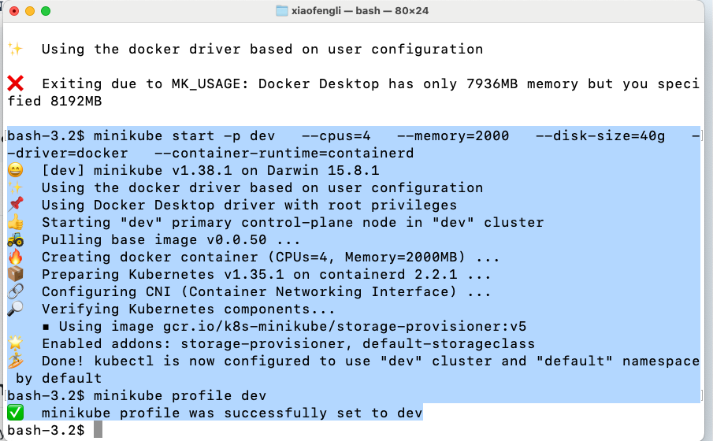
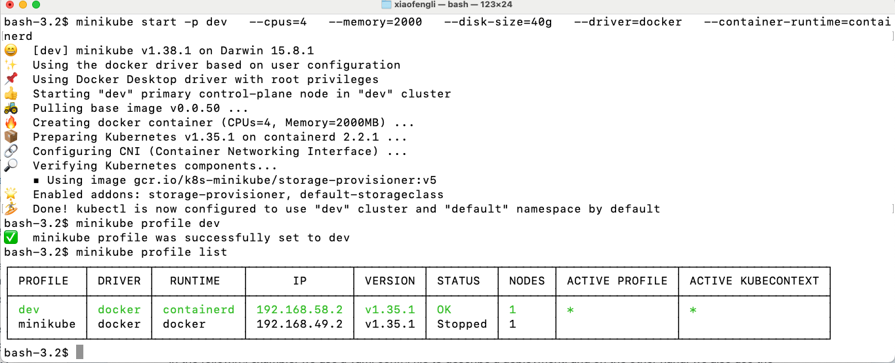

# Create a reusable Minikube profile (dev)

This lets you start/stop a consistent config anytime.

## Create + start profile
   
```commandline
minikube start -p dev \
  --cpus=4 \
  --memory=8192 \
  --disk-size=40g \
  --driver=docker \
  --container-runtime=containerd
```

If Docker Desktop has less memory than requested (for example, `--memory=8192` when Docker Desktop only has 7936MB), minikube exits with `MK_USAGE`. Lower the value (for example `--memory=2000`) or increase Docker Desktop's memory, then run the command again.



## Use the profile

Set `dev` as the active profile:

```commandline
minikube profile dev
```

List all profiles:

```commandline
minikube profile list
```



Stop + delete (if needed):

```commandline
minikube stop -p dev
```

```commandline
minikube delete -p dev
```

## 2. Sample App Deployment (Nginx demo)

In the following example, we use a yaml config file to describe a deployment, and on the other hand,
we also use the profile to specify the minikube profile config.

Drop this into a file like `nginx-demo.yaml`:

```
apiVersion: apps/v1
kind: Deployment
metadata:
  name: nginx-demo
spec:
  replicas: 2
  selector:
    matchLabels:
      app: nginx-demo
  template:
    metadata:
      labels:
        app: nginx-demo
    spec:
      containers:
      - name: nginx
        image: nginx:latest
        ports:
        - containerPort: 80
---
apiVersion: v1
kind: Service
metadata:
  name: nginx-demo
spec:
  type: NodePort
  selector:
    app: nginx-demo
  ports:
  - port: 80
    targetPort: 80
    nodePort: 30080
```


* Deploy it:

```commandline
kubectl apply -f nginx-demo.yaml
```

* Check pods:

```commandline
kubectl get pods
```

* Get service URL:

```commandline
minikube service nginx-demo --url -p dev
```

### 3. Mini kubectl Cheat Sheet (Minikube-friendly)

* Pods / Deployments

```commandline
kubectl get pods
```

```commandline
kubectl get deploy
```

```commandline
kubectl describe pod <podname>
```

* Logs

```commandline
kubectl logs <podname>
```

```commandline
kubectl logs -f <podname>
```

* Port-forward

```commandline
kubectl port-forward deployment/nginx-demo 8080:80
```

* Apply / Delete

```commandline
kubectl apply -f file.yaml
```

```commandline
kubectl delete -f file.yaml
```

* Quick shell into a pod

```commandline
kubectl exec -it <podname> -- bash
```
